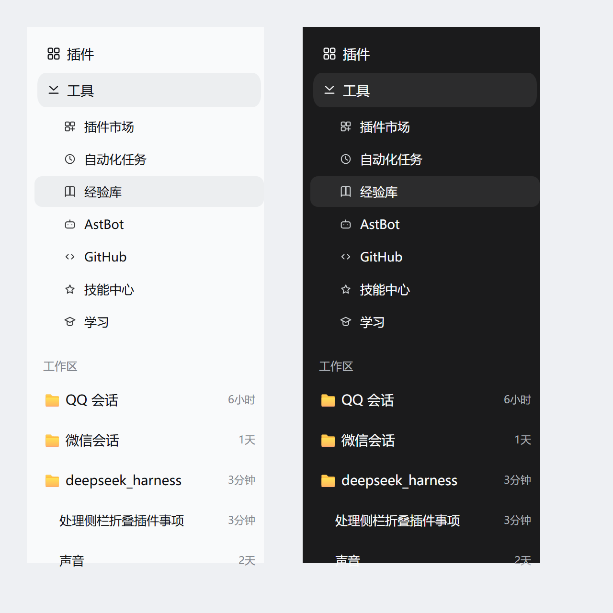

# dsh-sidebar-fold

DeepSeek Harness（DSH）桌面端的侧栏收纳插件：把插件注册的一堆面板行收成一行「工具」，点一下在行内向下展开。



> 上图是用宿主的配色与度量复刻的示意，不是真实截图。

## 它解决什么

DSH 的侧栏里，每个插件都会往 `sidebar.panellist` 注册一个面板行。装得越多，留给「工作区 / 会话列表」的高度就越少。

这个插件把除「插件」以外的面板行收起来，只留一行「工具」。

## 行为

- 侧栏只保留 `插件` 和 `工具` 两行，其余面板行收进「工具」。
- 鼠标停在「工具」上（约 120ms）或直接点它 → 在那一行**下方就地展开**，像 Workspace 展开那样把下面的内容顶下去；不是浮层，不盖住聊天区。
- 展开项显示原面板的图标和名字，当前面板带底色；点一项即跳到那个面板并收起；鼠标移开约 150ms 后自动收起。
- 点别处、按 `Esc` 收起。
- 宿主自带的「更多」行会一起收起（它只提供 pin 与插件浏览，收进展开块会套娃）。

## 安装

这是一个 DSH client 插件（bundle）。先在仓库里打包：

```bash
npm pack
```

然后把产物交给 DSH 的插件管理器安装，target 传 `file:<tgz 绝对路径>`：

```
install_bundle  file:D:/path/to/dsh-sidebar-fold-0.5.8.tgz
```

插件包自带 `cordis.patch.yml`（`insert` 的 id 是 `sidebar-fold`），装完重启应用生效。

## 实现要点

宿主没有「折叠成一行 + 就地展开」的官方 API，所以这里是 DOM 层实现：

- 面板行都在 `<nav aria-label="全局面板">` 里：读它，给其余行加 `display:none`，把展开块作为普通 DOM 插在「工具」那一行后面。
- 官方的收起机制（`sidebar.panellist.actions` 的 `onPinnedChange`）只传给**菜单内容**，而那个 slot 仅在「更多」菜单打开时挂载，拿不到启动时机，因此没有采用。
- 事件全部挂在 `document` 的**捕获阶段**：宿主重渲染会换掉行节点，挂在行上的监听器会跟着失效。
- 点击在捕获阶段 `stopPropagation`：行本身是宿主的 `<button>`，不拦住的话宿主会去 `selectPanel('sidebar-fold')`——那个主面板不存在，会抛错。
- 展开块必须从「面板行」扫描里排除自己，否则它插进去后会被当成一行面板、被自己的规则加上 `display:none`（0.5.4–0.5.7 的 bug）。

## 已知限制

- 纯 DOM 方案：宿主改版导致侧栏结构变化时可能失效。
- 被收起的行是 `display:none`，对读屏不友好；展开项有 Tab 顺序，但没有把焦点主动转进去。
- 收起状态不持久化（每次启动重新收一次，无副作用）。

## 开发

```bash
npm install
npm test                   # jsdom + 真 React 18：收起 / 点开 / 点外面收起 / 点项转发
npm run diag               # 可选：接收插件自诊断（127.0.0.1:18555）
```

插件在关键节点会向 `127.0.0.1:18555` 打一条极小的诊断（模块加载 / 注册 / 挂载 / 找到列表 / 点击 / 插入 / 失败原因）。没起这个服务时请求只是失败，不影响使用。`dev/preview.html` 是离线预览页，`docs/preview.png` 由它渲染。

## License

MIT
